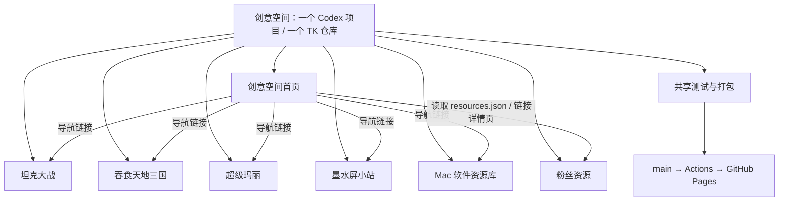

# 创意空间 · 项目关系与统一工作流程

2026-10-28 起，Codex 只保留「创意空间」一个项目入口。下面七个子项目统一接任务和发布，各自保留业务目录与版本。当前状态见 [项目台账](docs/项目状态.md)，核验依据见 [本轮记录](docs/管理/2026-10-28-统一管理/project.md)。

## 1. 项目归属

| 子项目 | 职责与维护入口 | 标签命名空间 |
|---|---|---|
| 创意空间首页 | `创意空间首页/index.html`；总入口、导航、创意卡片、资源展示、版本目录生成 | `site/home` |
| 坦克大战 | `坦克大战/tank-battle.html`；游戏、图集与专用测试 | `game/tank-battle` |
| 吞食天地三国 | `吞食天地三国/网页复刻/吞食天地Ⅱ同人复刻-网页版/`；当前引擎、素材与测试 | `game/three-kingdoms` |
| 超级玛丽 | `超级玛丽/src/`；经 `build.sh` 生成 `index.html` | `game/super-mario` |
| 墨水屏小站 | `墨水屏小站/index.html`；网页信息屏；`原生版/` 是同项目实验线 | `game/idle-screen` |
| Mac 软件资源库 | `Mac软件资源库/index.html`、`software-resources.json`；软件资料与检索 | `resource/mac-software-library` |
| 粉丝资源 | `粉丝资源/resources.json`、`资源/`；视频资料目录、详情页与公共交互 | `content/fan-resources` |

所有标签使用 `<命名空间>/vX.Y.Z`。墨水屏小站虽然是工具，仍沿用既有 `game/idle-screen` 命名空间，避免版本链断裂。子项目不是 Git 分支；分支用于阶段工作，版本标签用于记录里程碑。

根目录 `.github/`、`scripts/`、`docs/`、规则/交接文档、部署跳转页属于共享设施，不另计项目。空的 `纯实验/` 已清理；`.site/` 是按需生成的目录，均不计为第八个子项目。

## 2. 实际依赖关系

- 首页不拥有各子项目的业务源码。游戏各自运行，不通过首页调用兄弟游戏的实现。
- 首页的 `game-catalog.template.json` 是创意卡片定义；生成器根据当前提交可达的稳定 Git 标签生成 `game-catalog.json`。当前五张卡片对应三个游戏、墨水屏小站、Mac 软件资源库；加上首页本身与粉丝资源，共七个项目。
- 粉丝资源是资料内容的唯一维护处。首页只读取和展示 `resources.json`；新增资料通常无需改首页 HTML，但需要验证首页与详情页联动。当前七条资料是内容条目，不是七个新项目。
- Mac 软件资源库与粉丝资源平级，拥有自己的软件 JSON 和测试。`粉丝资源/资源/Mac软件资源库/` 只保留旧网址跳转，不恢复成第二份软件数据源。
- 三国的 `three-kingdoms.html` 是历史单文件实现；当前入口跳到网页复刻引擎。退役源码和测试仅在 GitHub 保存；本地默认只验当前引擎，发布包为旧网址生成跳转页。
- 墨水屏原生实验属于墨水屏小站，不能另算正式网页项目；不进入 Pages 发布包，也不因网页发布自动安装到 Kindle。
- 所有子项目共享 `scripts/check-all.cjs`、`scripts/build-site.cjs` 和 `.github/workflows/pages.yml`。因此任何项目发布都必须检查共享门禁。

## 3. 以后如何接任务

1. 在创意空间接需求，先读根规则、当前台账，再读目标子项目的 `AGENTS.md`、`README.md`、`project.md`。需求不清楚先问。
2. 查看工作区、最新远端 main 与标签，辨明旧版本、已发布内容和本地独有改动。不能只根据本地 `git status` 判断哪些功能尚未发布。
3. 划定目标目录与联动文件；同一需求内处理必要的跨目录修改，不再让用户切换到被取消的子项目入口。
4. 默认顺序处理需求。需要隔离时使用 `codex/` 分支或工作树；发布前统一集成到最新 main，避免多条发布线互相覆盖。
5. 本地直接维护当前源码，旧版从 GitHub 获取，不再复制备份；实现后执行专项验证，必要时检查真实浏览器行为，再更新项目记录、SHA-256、本地总记录与状态台账。
6. 向用户交付本地结果、验证证据与剩余边界，等待“推送”指令。未经发布指令，不自动提交、打标签、推送或部署。

## 4. 改动影响范围

| 需求 | 主要修改目录 | 必须一并检查 |
|---|---|---|
| 游戏或墨屏功能调整 | 对应子目录 | 专项测试；入口/版本变化时检查首页目录；发布时全仓门禁 |
| 新增或修订视频资料 | 粉丝资源 | 数据校验、详情页、公共样式/脚本、首页读取、发布包 |
| 软件资料更新 | Mac软件资源库 | 软件 JSON、筛选/复制、首页卡片和旧地址兼容 |
| 首页改版 | 创意空间首页 | 五张创意卡片、粉丝资源加载、全部入口与手机版式 |
| 新增/改名/移除创意 | 对应子目录及共享文档 | 首页模板、打包清单、验证清单、标签规范、兼容网址和交接指南 |
| 测试/部署设施调整 | scripts、.github、首页的版本生成与验收代码 | 全项目门禁、发布包与线上验收；各业务源码仍保留原目录 |
| 仅管理文档调整 | 共享文档及涉及的子项目文档 | 规则一致性、路径/版本/证据；不增加业务版本 |

## 5. GitHub 与发布

- 仓库：`sunsharebay-lgtm/TK`，远端 `origin`，默认和部署分支均为 `main`。
- Pages：`https://sunsharebay-lgtm.github.io/TK/`，根页面跳转到 `创意空间首页/`。七个子项目沿用原网址。
- 标签记录版本，Pages 由 main 推送或针对 main 的手动运行部署；产物为 `.site/`，排除历史、测试、开发文档和原生实验。
- 用户说“推送”后，按 [发布协议](docs/发布协议.md) 走完验证、提交、需要的标签、推送、Actions 和线上验收。只暂存本次明确的文件，先检查暂存差异，不用无差别全量暂存。
- 不把“仓库更新成功”“标签存在”“工作流启动”当成发布完成。部署提交必须正确，线上入口、实际脚本和数据必须通过验收。
- GitHub 仓库 About 本轮仍显示历史描述“坦克大战网页版源码与历史版本”；项目实际已是七项目集合。该元数据尚未修改，后续用户要求整理 GitHub 展示时可同步；不必改仓库名或公开地址。

## 6. 文档与恢复

最新事实维护在 `docs/项目状态.md`；项目细节在各自 `project.md` 和追加式 `更新记录.md`。根 `更新记录.md` 只在本地保存，禁止强制加入 Git。旧报告保留日期和历史口径，不继续冒充当前状态。

新增项目或管理方式变化时同步根 `AGENTS.md`、README、本文、文件夹说明、交接指南和相关子项目规则；不再创建本地历史源码备份；更新交接文档即可，不重置旧任务或技能配置。
